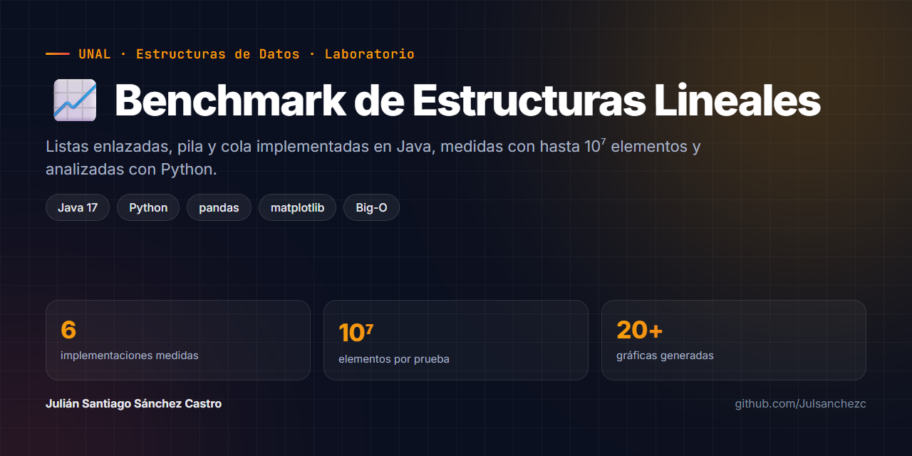
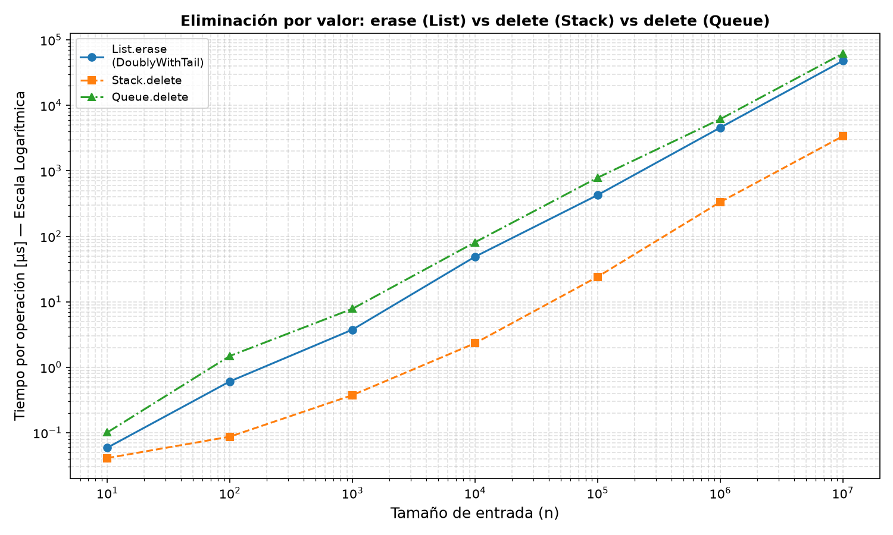

<p align="center">
  
</p>

<p align="center">
  
  
  
  
</p>

# 📈 Laboratorio: Benchmark de Estructuras de Datos Lineales

Implementación desde cero en **Java** de listas enlazadas, pila y cola, con un **benchmark automatizado** que mide cada operación con entradas de hasta **10⁷ elementos** y un pipeline en **Python** que genera las gráficas comparativas. El objetivo: comprobar en la práctica que la complejidad teórica (Big-O) se cumple.

Laboratorio de **Estructuras de Datos · Universidad Nacional de Colombia · 2026-I**.

## ✨ Lo más destacado

- 🔗 **6 implementaciones**: lista simple y doble, cada una con y sin puntero a la cola, `ArrayStack` y `ArrayQueue` (arreglo circular dinámico).
- ⏱️ **Medición cuidadosa**: calentamiento del JIT, cada operación medida aislada sobre una estructura de tamaño exacto N, mediana de 15 muestras y semilla fija.
- 📊 **Más de 20 gráficas** en escala log-log generadas automáticamente con pandas y matplotlib.
- 🚀 **Un solo comando** (`start.sh`) compila Java, corre el benchmark, crea el entorno de Python y genera las gráficas.

<p align="center">
  
</p>

---

## Estructuras implementadas

### Listas enlazadas — `IList`

| Clase | `pushFront` | `pushBack` | `popFront` | `popBack` | `find` / `erase` |
|---|:---:|:---:|:---:|:---:|:---:|
| `SinglyLinkedList` | O(1) | O(n) | O(1) | O(n) | O(n) |
| `SinglyLinkedListWithTail` | O(1) | O(1) | O(1) | O(n) | O(n) |
| `DoublyLinkedList` | O(1) | O(n) | O(1) | O(n)† | O(n) |
| `DoublyLinkedListWithTail` | O(1) | O(1) | O(1) | O(1) | O(n) |

† Aunque cada nodo conoce a su anterior, sin puntero a la cola hay que recorrer toda la lista para llegar al último nodo. El puntero `prev` solo hace O(1) el `popBack` cuando además existe `tail`.

### Pila — `IStack<T>`

| Clase | `push` | `pop` | `peek` | `delete` |
|---|:---:|:---:|:---:|:---:|
| `ArrayStack<T>` | O(1)* | O(1) | O(1) | O(n) |

### Cola — `IQueue<T>`

| Clase | `enqueue` | `dequeue` | `front` | `delete` |
|---|:---:|:---:|:---:|:---:|
| `ArrayQueue<T>` | O(1)* | O(1) | O(1) | O(n) |

\* amortizado — el arreglo interno se duplica cuando se llena.

---

## Requisitos

| Herramienta | Versión mínima |
|---|---|
| Java JDK | 17 |
| Python | 3.9 |
| Git Bash (Windows) | cualquiera |

> En Windows se requiere Git Bash para ejecutar `start.sh`.  
> En Linux/Mac, si la compilación falla, reemplaza el bloque de compilación en `start.sh` por:
> ```bash
> echo "Compilando Java..."
> OUT="$ROOT/out/classes"
> mkdir -p "$OUT"
> find "$ROOT/app" -name "*.java" > "$ROOT/out/sources.txt"
> javac -encoding UTF-8 -d "$OUT" @"$ROOT/out/sources.txt"
> echo "Compilación exitosa"
> ```

---

## Inicio rápido

```bash
# 1. Clonar el repositorio
git clone https://github.com/Julsanchezc/Laboratorio-.git
cd Laboratorio-

# 2. Copiar la configuración
cp .env.example .env

# 3. Ejecutar todo (benchmark Java + gráficos Python)
bash start.sh
```

`start.sh` hace automáticamente:
1. Detecta Python del sistema y crea el entorno virtual `venv/`
2. Instala `matplotlib` y `pandas` en el venv
3. Compila todos los `.java` de `app/`
4. Ejecuta el benchmark → genera `results/benchmark_results.csv`
5. Genera 20 gráficos PNG (escala lineal y logarítmica) → `results/graphs/`

---

## Configuración

Edita `.env` (nunca se sube al repositorio):

```env
# Tamaños de entrada (separados por coma, sin espacios)
BENCHMARK_SIZES=10,100,1000,10000,100000,1000000

# Muestras por operación (se reporta la mediana)
BENCHMARK_SAMPLES=15

# Nivel de log: INFO | WARNING | FINE | SEVERE
LOG_LEVEL=INFO
```

> Con los valores por defecto el benchmark tarda alrededor de un minuto. Los resultados publicados en `results/` se generaron agregando `10000000` (10⁷), que tarda varios minutos y necesita unos 2 GB de RAM. No se recomienda 10⁸: no cabe en la memoria de un equipo normal.

---

## Metodología de medición

Medir operaciones de nanosegundos en Java tiene varias trampas. El benchmark las evita así:

| Problema | Solución |
|---|---|
| El JIT compila el código mientras corre, así que las primeras mediciones salen infladas | Cada benchmark hace primero una **pasada de calentamiento** completa que no se registra |
| El resultado de una operación depende del tamaño de la estructura | Cada operación se mide sobre una estructura con **exactamente N** elementos; después de cada medición, un paso **no cronometrado** la devuelve a tamaño N (por ejemplo, `pushFront` se deshace con `popFront`) |
| Picos ocasionales del recolector de basura o del sistema operativo | Cada operación se mide 15 veces y se reporta la **mediana** |
| `System.nanoTime()` tiene resolución limitada (100 ns en muchos equipos con Windows) y una operación O(1) tarda ~10 ns | Si una sola llamada es demasiado rápida para medirla, se ejecuta una vez sobre cada una de varias **copias idénticas** de la estructura (o varias veces seguidas cambiando el tamaño menos de 0,1 %) y se divide el tiempo total |
| Medir el mejor caso en lugar del peor | `find`, `erase`, `addBefore` y `addAfter` buscan un valor que está **al final** de la lista; `delete` de la pila elimina el elemento del **fondo** (hay que desplazar todos los demás) y el de la cola elimina el del **final** (hay que recorrerla entera) |

`push` y `enqueue` se reportan como **costo amortizado**: el tiempo de llenar la estructura con N elementos dividido entre N, que incluye las veces que el arreglo interno se duplica.

> Los tiempos absolutos de las operaciones O(1) (~10–50 ns) incluyen el costo fijo del arnés de medición. Lo importante es **cómo crece** el tiempo con N: las operaciones O(1) se mantienen planas y las O(n) crecen en proporción a N.

---

## Ejecución manual

**Solo Java (sin gráficos):**
```bash
bash run.sh
```

**Solo gráficos (requiere que ya exista el CSV):**
```bash
venv/Scripts/python analysis/plot_lists.py
venv/Scripts/python analysis/plot_stack_queue.py
venv/Scripts/python analysis/plot_comparison.py
```

---

## Estructura del proyecto

```
Laboratorio-/
├── .env.example                   ← plantilla de configuración
├── .gitignore
├── requirements.txt               ← dependencias Python
├── start.sh                       ← orquestador principal (Java + Python)
├── run.sh                         ← solo compilar y ejecutar Java
├── pom.xml                        ← referencia Maven (no requerido para compilar)
│
├── app/                           ← código fuente Java
│   ├── core/
│   │   ├── AppConfig.java         ← singleton: lee variables desde .env
│   │   └── AppLogger.java         ← singleton: logger global → logs/logs.log
│   ├── datastructures/
│   │   ├── nodes/
│   │   │   └── Node.java          ← nodo compartido (value, next, prev)
│   │   ├── lists/
│   │   │   ├── IList.java
│   │   │   ├── SinglyLinkedList.java
│   │   │   ├── SinglyLinkedListWithTail.java
│   │   │   ├── DoublyLinkedList.java
│   │   │   └── DoublyLinkedListWithTail.java
│   │   ├── stack/
│   │   │   ├── IStack.java
│   │   │   └── ArrayStack.java
│   │   └── queue/
│   │       ├── IQueue.java
│   │       └── ArrayQueue.java    ← arreglo circular dinámico
│   └── benchmark/
│       ├── Benchmark.java         ← utilidades de medición con System.nanoTime()
│       ├── ListBenchmark.java
│       ├── StackBenchmark.java
│       ├── QueueBenchmark.java
│       ├── ResultCollector.java   ← acumula resultados en memoria → exporta CSV
│       └── Main.java              ← punto de entrada
│
├── analysis/                      ← scripts Python de visualización
│   ├── plot_lists.py              ← Parte 1: gráficos por implementación de lista
│   ├── plot_stack_queue.py        ← Parte 2: Stack vs Queue
│   └── plot_comparison.py         ← Parte 3: comparativa List vs Stack vs Queue
│
├── logs/                          ← generado en runtime (gitignored)
│   └── logs.log                   ← se sobreescribe en cada ejecución
├── results/                       ← resultados publicados (se regeneran al ejecutar)
│   ├── benchmark_results.csv      ← se sobreescribe en cada ejecución
│   └── graphs/                    ← 20 PNG (en el repo se publican los de escala logarítmica)
└── out/                           ← clases Java compiladas (gitignored)
```

---

## Salidas generadas

### CSV — `results/benchmark_results.csv`

| Columna | Descripción |
|---|---|
| `structure` | Nombre de la estructura (`SinglyLinkedList`, `ArrayStack`, etc.) |
| `operation` | Operación medida (`pushFront`, `enqueue`, `find`, etc.) |
| `size` | Tamaño de entrada `n` |
| `time_ns` | Tiempo por operación en nanosegundos (mediana, o costo amortizado en `push`/`enqueue`) |
| `time_us` | El mismo valor en microsegundos |

### Gráficos — `results/graphs/`

| Archivo | Contenido |
|---|---|
| `SinglyLinkedList.png` | Todas las operaciones vs `n` (escala log-log) |
| `SinglyLinkedListWithTail.png` | ídem |
| `DoublyLinkedList.png` | ídem |
| `DoublyLinkedListWithTail.png` | ídem |
| `compare_pushFront.png` | Las 4 listas comparadas para `pushFront` |
| `compare_pushBack.png` | ídem para `pushBack` |
| `compare_popFront.png` | ídem para `popFront` |
| `compare_popBack.png` | ídem para `popBack` |
| `compare_find.png` | ídem para `find` |
| `compare_erase.png` | ídem para `erase` |
| `compare_addBefore.png` | ídem para `addBefore` |
| `compare_addAfter.png` | ídem para `addAfter` |
| `ArrayStack.png` | Todas las operaciones de Stack vs `n` |
| `ArrayQueue.png` | Todas las operaciones de Queue vs `n` |
| `stack_vs_queue.png` | Stack vs Queue en operaciones equivalentes |
| `comparison_01.png` | Inserción al frente: `pushFront` vs `push` |
| `comparison_02.png` | Inserción al final: `pushBack` vs `enqueue` |
| `comparison_03.png` | Eliminación al frente: `popFront` vs `pop`/`dequeue` |
| `comparison_04.png` | Búsqueda: `find` vs `peek`/`front` |
| `comparison_05.png` | Eliminación por valor: `erase` vs `delete` |

---

## Decisiones de diseño

- **Medición separada de I/O**: `ResultCollector` acumula todos los resultados en memoria y exporta el CSV *después* de que termina todo el timing, para no contaminar las mediciones con operaciones de disco.
- **Semilla fija** (`Random(42)`): todos los benchmarks usan la misma semilla aleatoria para garantizar reproducibilidad entre ejecuciones.
- **Nodo compartido**: `Node.java` unifica `next` y `prev` en un solo nodo, eliminando duplicación entre listas simples y dobles. Las listas simples simplemente no usan `prev`.
- **Arreglo circular** (`ArrayQueue`): mantiene punteros `head` y `tail` con aritmética modular para lograr `enqueue`/`dequeue` en O(1) sin desplazar elementos.
